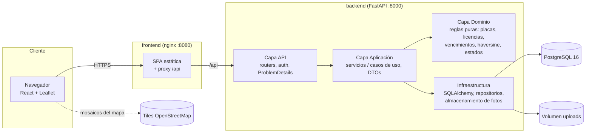

# FlotaPe · Gestión de Flota y Delivery

[](.github/workflows/ci.yml)


Sistema full-stack para operar una flota de reparto urbano en Perú: vehículos con **placa peruana validada**, **SOAT y revisión técnica con alertas de vencimiento**, conductores con licencia MTC, pedidos geolocalizados, **rutas con orden de paradas optimizado (vecino más cercano + haversine)**, entregas con **prueba fotográfica o nota**, **mantenimiento preventivo por kilometraje** y **control de combustible (km/l)**. Incluye un panel web con mapa (Leaflet + OpenStreetMap) y una vista móvil para conductores.

> Todos los datos de demostración (personas, DNI, teléfonos, placas, direcciones) son **ficticios**.

---

## Tabla de contenidos

1. [Características](#características)
2. [Arquitectura](#arquitectura)
3. [Stack y justificación](#stack-y-justificación)
4. [Inicio rápido con Docker](#inicio-rápido-con-docker-un-comando)
5. [Ejecución sin Docker](#ejecución-sin-docker)
6. [Credenciales demo](#credenciales-demo)
7. [Endpoints principales](#endpoints-principales)
8. [Pruebas](#pruebas)
9. [Estructura de carpetas](#estructura-de-carpetas)
10. [Variables de entorno](#variables-de-entorno)
11. [Qué aprenderás con este proyecto](#qué-aprenderás-con-este-proyecto)
12. [Roadmap](#roadmap)
13. [Licencia y autor](#licencia-y-autor)

---

## Características

| Módulo | Qué hace | Reglas de negocio destacadas |
|---|---|---|
| **Vehículos** | CRUD con búsqueda, filtros, orden y paginación | Placa `ABC-123` / moto `1234-AB` normalizada y única; el odómetro nunca retrocede; no se elimina un vehículo con historial (se inactiva) |
| **Documentos** | SOAT y revisión técnica por vehículo | Estado `vigente` / `por_vencer` (≤30 días) / `vencido`; un vehículo con documentos vencidos **no puede salir a ruta** |
| **Conductores** | Licencia MTC (letra + DNI) y categoría | La licencia debe corresponder al DNI; la categoría debe habilitar el tipo de vehículo (moto → B-IIx, camión → A-IIb+) |
| **Pedidos** | Dirección, distrito, coordenadas, peso y fecha | Coordenadas dentro de Perú (detecta lat/lng invertidas); máquina de estados explícita |
| **Rutas** | Asignación de pedidos a vehículo + conductor | Capacidad en kg, documentos y licencia vigentes el día de la ruta, mantenimiento al día, sin doble asignación el mismo día; orden de paradas por **vecino más cercano** |
| **Entregas** | El conductor marca entregado / no entregado | Entregar exige **foto (JPG/PNG/WEBP validada por firma binaria) o nota**; la ruta se cierra sola al terminar la última parada |
| **Mantenimiento** | Preventivo y correctivo | El preventivo reinicia el contador de km; alerta a 500 km; si está vencido, bloquea rutas |
| **Combustible** | Cargas de combustible y rendimiento | Odómetro estrictamente creciente; km/l por método tanque lleno a tanque lleno; el conductor solo registra el vehículo de su ruta |
| **Alertas y dashboard** | KPIs del día, mapa de pedidos, entregas de 7 días, tasa de éxito | Alertas calculadas en tiempo real (no se desincronizan) |
| **Seguridad** | JWT + roles `admin`, `despachador`, `conductor` | Argon2id, autorización por endpoint, usuarios desactivados pierden acceso inmediato |

Frontend: login, layout con sidebar responsive, **modo oscuro**, tablas con búsqueda/filtros/paginación, formularios con validación, estados de carga/vacío/error, mapa con paradas numeradas y trazado de la ruta, planificador con barra de capacidad y previsualización del ahorro de la optimización.

---

## Arquitectura



Detalle de capas, flujo de una petición y decisiones en [`docs/arquitectura.md`](docs/arquitectura.md). Modelo de datos en [`docs/modelo-datos.md`](docs/modelo-datos.md).

---

## Stack y justificación

| Capa | Tecnología | Por qué |
|---|---|---|
| API | **FastAPI 0.115** | Tipado con Pydantic, OpenAPI automático, inyección de dependencias nativa |
| Validación / DTOs | **Pydantic v2** | Validación rápida (núcleo en Rust) y mensajes de error estructurados |
| ORM | **SQLAlchemy 2.0** (estilo `Mapped[]`) | Tipado estático, consultas explícitas, portable entre PostgreSQL y SQLite |
| Migraciones | **Alembic** | Versionado del esquema; una prueba verifica que modelo y migración coinciden |
| Base de datos | **PostgreSQL 16** | Integridad referencial, `CHECK` constraints, índices compuestos |
| Auth | **PyJWT + Argon2id** (`argon2-cffi`) | Argon2id es el algoritmo recomendado por OWASP para contraseñas |
| Frontend | **React 18 + Vite 5 + TypeScript** | Ecosistema maduro, build rápido, tipado de extremo a extremo |
| Estilos | **Tailwind CSS 3** | Diseño consistente y modo oscuro con `class` sin CSS a medida |
| Mapas | **Leaflet 1.9.4 + react-leaflet 4.2.1 + OpenStreetMap** | Libre, sin API key ni costos por uso |
| Pruebas | **pytest + httpx** / **Vitest + Testing Library** | Pruebas rápidas sin servicios externos |
| Contenedores | **Docker multi-stage**, usuario no root | Imágenes pequeñas y con menor superficie de ataque |

---

## Inicio rápido con Docker (un comando)

Requisitos: Docker Desktop 4.x (o Docker Engine + Compose v2).

```bash
cp .env.example .env        # opcional: personaliza puertos y secretos
docker compose up -d --build
```

| Servicio | URL |
|---|---|
| Panel web | http://localhost:8080 |
| API (Swagger UI) | http://localhost:8000/docs |
| ReDoc | http://localhost:8000/redoc |
| Salud | http://localhost:8000/health |

Al arrancar, el backend aplica las migraciones (`alembic upgrade head`) y, si `SEED_DEMO_DATA=true`, siembra datos ficticios **relativos a la fecha de hoy** (rutas del día, alertas por vencer e historial de la última semana).

---

## Ejecución sin Docker

### Backend (Python 3.12+)

```bash
cd backend
python -m venv .venv
# Windows: .venv\Scripts\activate   |   Linux/macOS: source .venv/bin/activate
pip install -r requirements-dev.txt
cp .env.example .env              # usa SQLite por defecto; cambia DATABASE_URL para PostgreSQL
alembic upgrade head              # crea el esquema
python -m app.seed                # datos demo (idempotente)
uvicorn app.main:app --reload     # http://localhost:8000/docs
```

> `python -m app.seed --reset` borra y recrea las tablas (bloqueado si `ENVIRONMENT=production`).

### Frontend (Node 20+)

```bash
cd frontend
npm install
npm run dev                       # http://localhost:5173 (proxy /api -> http://localhost:8000)
```

Si tu API corre en otro puerto: `API_PROXY_TARGET=http://localhost:9000 npm run dev`.

---

## Credenciales demo

Contraseña para todas las cuentas: **`Demo123!`**

| Rol | Email | Qué puede hacer |
|---|---|---|
| Administrador | `admin@demo.pe` | Todo, incluida la gestión de usuarios y la eliminación de vehículos/conductores |
| Despachador | `despacho@demo.pe` | Flota, conductores, pedidos, rutas, mantenimiento, combustible, alertas y dashboard |
| Conductor | `conductor@demo.pe` | Sus rutas del día, registrar entregas (foto/nota), entregas fallidas y combustible de su vehículo |
| Conductor | `conductor2@demo.pe` | Igual que el anterior (tiene una ruta planificada y licencia por vencer) |

---

## Endpoints principales

Documentación interactiva completa en `/docs`. Ejemplos `curl` en [`docs/guia-api.md`](docs/guia-api.md).

| Método | Ruta | Rol | Descripción |
|---|---|---|---|
| POST | `/api/auth/login` | público | Obtiene el JWT |
| GET | `/api/auth/me` | autenticado | Usuario actual |
| GET/POST/PUT | `/api/users` | admin | Gestión de usuarios |
| GET | `/api/vehicles?q=&status=&vehicle_type=&sort=&page=&size=` | todos | Vehículos con estado de documentos y mantenimiento |
| POST/PUT | `/api/vehicles` | admin, despachador | Alta / edición |
| DELETE | `/api/vehicles/{id}` | admin | Baja (solo sin historial) |
| GET/POST/PUT | `/api/drivers` | admin, despachador | Conductores y licencias |
| GET/POST/PUT | `/api/orders` | admin, despachador | Pedidos (filtros por estado, fecha, distrito, ruta) |
| POST | `/api/orders/{id}/cancel` · `/reschedule` | admin, despachador | Cancelar / reprogramar fallidos |
| POST | `/api/orders/{id}/deliver` | conductor dueño, staff | Entrega con prueba (multipart: `photo`, `note`) |
| POST | `/api/orders/{id}/fail` | conductor dueño, staff | Entrega fallida con motivo |
| GET | `/api/orders/{id}/photo` | autenticado | Foto de prueba |
| POST | `/api/routes/preview` | admin, despachador | Orden optimizado y ahorro vs orden manual |
| POST | `/api/routes` | admin, despachador | Crea ruta validando reglas y optimiza paradas |
| POST | `/api/routes/{id}/start` · `/cancel` | admin, despachador | Iniciar / cancelar |
| GET | `/api/routes/mine?route_date=` | conductor | Rutas propias con paradas |
| GET/POST | `/api/maintenance` · GET `/overview` | admin, despachador | Servicios y estado de la flota |
| GET/POST | `/api/fuel` · GET `/efficiency/{vehicle_id}` | staff (POST también conductor) | Cargas y rendimiento km/l |
| GET | `/api/alerts` | admin, despachador | Vencimientos y mantenimientos |
| GET | `/api/dashboard?date=` | admin, despachador | KPIs |
| GET | `/health` | público | Estado del servicio y la BD |

Todos los errores responden con **ProblemDetails** (`application/problem+json`):

```json
{
  "type": "https://httpstatuses.io/422",
  "title": "Regla de negocio incumplida",
  "status": 422,
  "detail": "La carga total (1250.5 kg) excede la capacidad del vehículo (1200.0 kg)",
  "instance": "/api/routes",
  "code": "capacity_exceeded",
  "request_id": "9f2c1d7a0b3e4c11"
}
```

---

## Pruebas

Las pruebas **no requieren Docker ni PostgreSQL**: el backend usa SQLite en memoria y un "hoy" fijo para que las alertas sean deterministas.

```bash
# Backend: 101 pruebas (unitarias de dominio + integración HTTP + migraciones)
cd backend
pytest -o addopts="" -v
ruff check . && ruff format --check .

# Frontend: 34 pruebas (utilidades, cliente API, componentes y validadores)
cd frontend
npm test
npm run build
```

| Suite | Qué cubre |
|---|---|
| `tests/unit/test_domain_rules.py` | Placas, licencias vs tipo de vehículo, vencimientos (bordes 0/30/31 días), transiciones de estado, capacidad, mantenimiento, combustible |
| `tests/unit/test_geo.py` | Haversine (1° en el ecuador = 111.19 km), vecino más cercano, desempates deterministas |
| `tests/unit/test_schemas_and_storage.py` | DTOs (contraseña, coordenadas en Perú), validación de imágenes por *magic bytes*, *path traversal* |
| `tests/integration/test_auth_and_access.py` | Login, ProblemDetails, 401/403 por rol, desactivación inmediata, auto-bloqueo del admin |
| `tests/integration/test_fleet_api.py` | CRUD, filtros/orden/paginación, mantenimiento, combustible, alertas |
| `tests/integration/test_dispatch_api.py` | Reglas de ruta (SOAT, RT, mantenimiento, licencia, capacidad, doble asignación) y flujo completo de entrega con foto |
| `tests/integration/test_migrations.py` | `alembic upgrade` + `alembic check` (modelo == migración) + `downgrade` |

---

## Estructura de carpetas

```text
gestion-flota-delivery/
├── backend/
│   ├── app/
│   │   ├── domain/            # Reglas de negocio puras (sin frameworks): placas, licencias, geo, estados…
│   │   ├── application/       # Casos de uso (services/), DTOs (schemas.py) y mapeos a DTO (mappers.py)
│   │   ├── infrastructure/    # SQLAlchemy: modelos, repositorios, motor; almacenamiento de fotos
│   │   ├── api/               # Routers HTTP, dependencias (auth, paginación, DI) y manejo de errores
│   │   ├── core/              # Configuración, seguridad (JWT/Argon2), logging JSON, reloj de Lima
│   │   ├── main.py            # Fábrica de la app (create_app)
│   │   └── seed.py            # Datos ficticios de demostración
│   ├── alembic/               # Migraciones versionadas
│   ├── tests/                 # unit/ e integration/
│   ├── Dockerfile             # Multi-stage, usuario no root
│   └── docker-entrypoint.sh   # migrar → sembrar (opcional) → uvicorn
├── frontend/
│   ├── src/
│   │   ├── api/               # Cliente HTTP (token, ProblemDetails) y tipos
│   │   ├── auth/              # Contexto de sesión y roles
│   │   ├── components/        # UI reutilizable, Layout con sidebar, MapView (Leaflet)
│   │   ├── lib/               # Formato, validaciones, estados, hooks, tema
│   │   └── pages/             # Una página por módulo
│   ├── Dockerfile             # Build con Node + nginx-unprivileged
│   └── nginx.conf             # SPA + proxy /api
├── docs/                      # Arquitectura, modelo de datos, guía de API y ADRs
├── .github/workflows/ci.yml   # Lint, pruebas y build de backend y frontend
├── docker-compose.yml         # db + backend + frontend
└── .env.example
```

---

## Variables de entorno

| Variable | Por defecto | Descripción |
|---|---|---|
| `DATABASE_URL` | `sqlite:///./flota-dev.db` | Cadena SQLAlchemy. En Docker: `postgresql+psycopg://…@db:5432/flota` |
| `JWT_SECRET` | valor de desarrollo | Clave HMAC del JWT (**mínimo 32 caracteres**, cámbiala) |
| `JWT_EXPIRE_MINUTES` | `120` | Vigencia del token |
| `CORS_ORIGINS` | `http://localhost:5173` | Orígenes permitidos, separados por comas |
| `DEPOT_LAT` / `DEPOT_LNG` | `-12.0464` / `-77.0428` | Depósito desde donde salen las rutas |
| `UPLOAD_DIR` | `./uploads` | Carpeta de fotos de prueba de entrega |
| `MAX_UPLOAD_MB` | `5` | Tamaño máximo de foto |
| `DOCUMENT_WARNING_DAYS` | `30` | Días de anticipación para alertas de SOAT/RT/licencia |
| `MAINTENANCE_WARNING_KM` | `500` | Km de anticipación para mantenimiento |
| `LOG_LEVEL` / `LOG_JSON` | `INFO` / `true` | Nivel y formato de logs |
| `SEED_DEMO_DATA` | `true` (compose) | Sembrar datos demo al arrancar el contenedor |
| `ENVIRONMENT` | `development` | `production` bloquea `seed --reset` |
| `API_PROXY_TARGET` (frontend dev) | `http://localhost:8000` | Destino del proxy de Vite |

---

## Qué aprenderás con este proyecto

- **Clean Architecture en Python**: separar reglas de negocio puras (fáciles de probar) de FastAPI y SQLAlchemy.
- **Inyección de dependencias con FastAPI** (`Depends`, `Annotated`) y una fábrica `create_app()` que permite probar contra SQLite en memoria.
- **Modelar reglas reales del transporte peruano**: placas SUNARP, licencias MTC por categoría, SOAT y revisión técnica.
- **Algoritmos aplicados**: distancia haversine y heurística del vecino más cercano para el problema del viajante (TSP), con sus límites.
- **Máquinas de estado** para evitar transiciones inválidas (entregar algo que nunca salió a ruta).
- **Errores consistentes con ProblemDetails (RFC 9457)** y logging estructurado con `request_id`.
- **Subida segura de archivos**: validación por firma binaria, límite de tamaño, nombres aleatorios y protección contra *path traversal*.
- **Migraciones con Alembic** y una prueba que detecta modelos sin migrar.
- **React profesional**: cliente API tipado, manejo global de 401, carga diferida, mapas con Leaflet, modo oscuro y validación de formularios.
- **Docker multi-stage, usuarios no root y CI** con GitHub Actions.

---

## Roadmap

- [ ] Distancias reales por calles con OSRM y ventanas horarias de entrega (VRPTW).
- [ ] Mejora 2-opt sobre el resultado del vecino más cercano.
- [ ] Seguimiento GPS en vivo del conductor (WebSocket) y ETA al cliente por SMS/WhatsApp.
- [ ] Almacenamiento de fotos en S3/MinIO y firma digital del receptor.
- [ ] Refresh tokens y revocación de sesiones.
- [ ] Reportes exportables (PDF/Excel) de costos por km y por vehículo.
- [ ] PWA offline para conductores con cola de sincronización.

---

## Nota sobre versiones

El backend se desarrolló y probó con **Python 3.12** (la imagen Docker y la CI usan `python:3.12`). El frontend usa Node 22 en Docker/CI y fue verificado localmente con Node 24.

---

## Licencia y autor

Distribuido bajo licencia **MIT**. Ver [`LICENSE`](LICENSE).

**Angel Castañeda Meza** — Ingeniero de Sistemas · Lima, Perú
GitHub: [@angel-cm-dev](https://github.com/angel-cm-dev)
