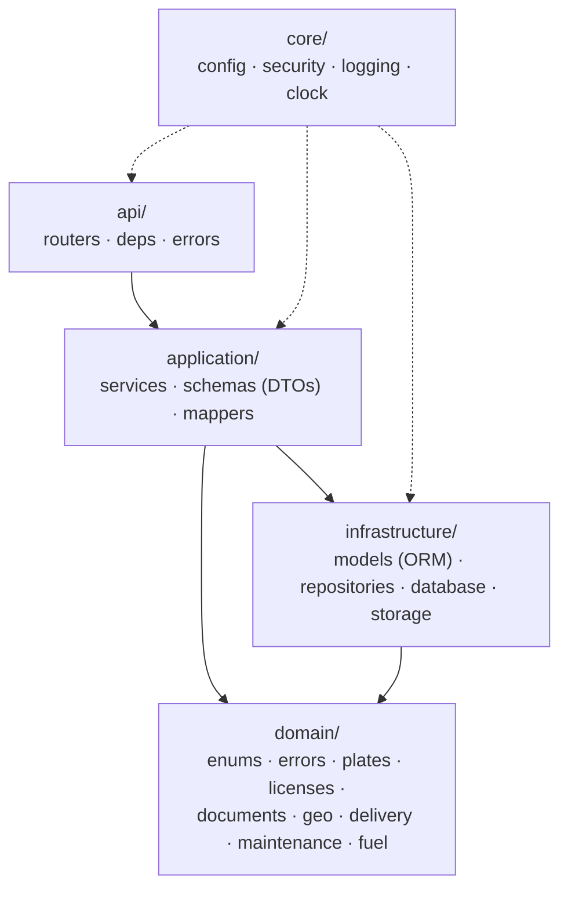
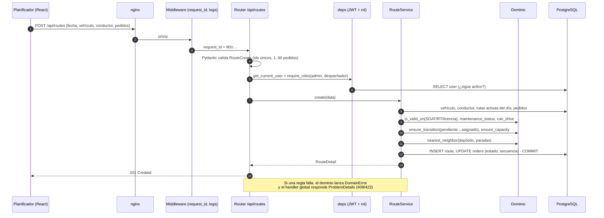
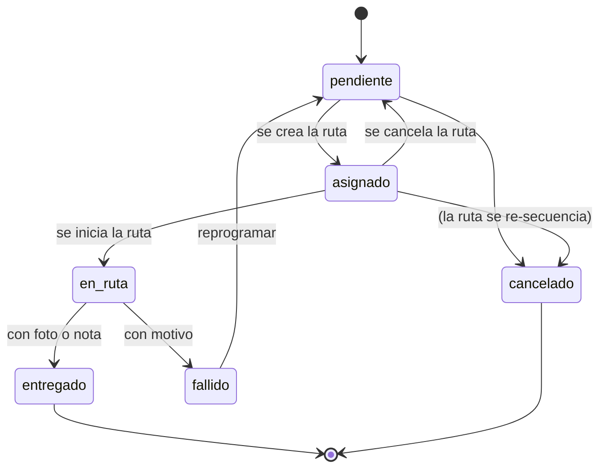

# Arquitectura

## 1. Capas del backend

El backend sigue una arquitectura en capas inspirada en *Clean Architecture*: las dependencias apuntan hacia adentro y las reglas de negocio no conocen ni HTTP ni SQL.



| Capa | Responsabilidad | Ejemplo | Depende de |
|---|---|---|---|
| **Dominio** | Reglas de negocio puras, deterministas y sin I/O | `nearest_neighbor()`, `can_drive("A-IIa", "furgoneta")`, `ensure_transition()` | Nada (solo stdlib) |
| **Aplicación** | Casos de uso: orquesta repositorios y reglas, define DTOs | `RouteService.create()` valida 10 reglas y secuencia paradas | Dominio, Infraestructura |
| **Infraestructura** | Persistencia y recursos externos | `RouteRepository.active_for()`, `LocalFileStorage.save_image()` | SQLAlchemy, disco |
| **API** | Transporte HTTP, autenticación/autorización, traducción de errores | `POST /api/routes` → 201 o ProblemDetails 409/422 | Aplicación |

### Inyección de dependencias

FastAPI construye por petición la cadena `Session → Service → Repository`:

```python
RouteSvc = Annotated[RouteService, Depends(service(RouteService))]

@routes_router.post("")
def create_route(data: s.RouteCreate, _: Staff, svc: RouteSvc): ...
```

- `get_db` abre una sesión desde `app.state.session_factory` y la cierra (con *rollback* si hubo error).
- `service(Cls)` inyecta sesión, configuración, el reloj (`today`) y, si el servicio lo pide, el almacenamiento de archivos.
- `require_roles(...)` es una dependencia que valida el rol; `Staff`, `AdminOnly` y `AnyRole` son alias legibles.

Como todo se arma en `create_app(settings, today=...)`, las pruebas crean la app con SQLite en memoria y una fecha fija sin *mocks* globales.

## 2. Flujo de una petición: crear una ruta



## 3. Máquina de estados de pedidos



Cuando la última parada de una ruta pasa a un estado final, la ruta pasa a `completada` y el conductor vuelve a `disponible`.

## 4. Optimización de paradas

1. Se parte del depósito (`DEPOT_LAT/LNG`).
2. Se elige la parada no visitada con menor distancia **haversine**; en empate, la de menor `id` (resultado reproducible).
3. Se repite hasta visitar todas y se suma el regreso al depósito.

Complejidad O(n²): con 60 paradas son ~3 600 cálculos, instantáneo. El endpoint `/api/routes/preview` muestra además la distancia en el orden elegido manualmente para cuantificar el ahorro (en los datos demo, ~40 %).

## 5. Seguridad

- Contraseñas con **Argon2id**; comparación contra un hash ficticio cuando el email no existe (tiempo de respuesta constante, evita enumerar usuarios).
- JWT HS256 con `sub`, `role`, `iat`, `exp`. En cada petición se recarga el usuario: desactivarlo revoca el acceso de inmediato.
- Autorización por endpoint y, además, **autorización a nivel de recurso**: un conductor solo puede ver/actualizar pedidos de *sus* rutas.
- Orden de listados por **lista blanca** de columnas (no hay SQL dinámico con texto del usuario).
- Fotos: validación por *magic bytes*, tamaño máximo, nombre aleatorio y verificación de ruta (anti *path traversal*).
- Cabeceras `X-Content-Type-Options`, `X-Frame-Options`, `Referrer-Policy` en API y nginx; contenedores sin root.

## 6. Observabilidad

- Logs JSON con `ts`, `level`, `logger`, `msg`, `request_id`, método, ruta, estado y duración.
- `X-Request-ID` se propaga desde el proxy o se genera; se devuelve en la respuesta y en los ProblemDetails.
- `/health` comprueba la conexión a la BD (200/503) y es usado por los `HEALTHCHECK` de Docker.

## 7. Decisiones

Ver [`decisiones/`](decisiones/):

- [ADR 0001 — FastAPI + SQLAlchemy 2 con capas](decisiones/0001-fastapi-sqlalchemy-capas.md)
- [ADR 0002 — Vecino más cercano con haversine](decisiones/0002-vecino-mas-cercano-haversine.md)
- [ADR 0003 — Alertas calculadas al vuelo](decisiones/0003-alertas-calculadas.md)
