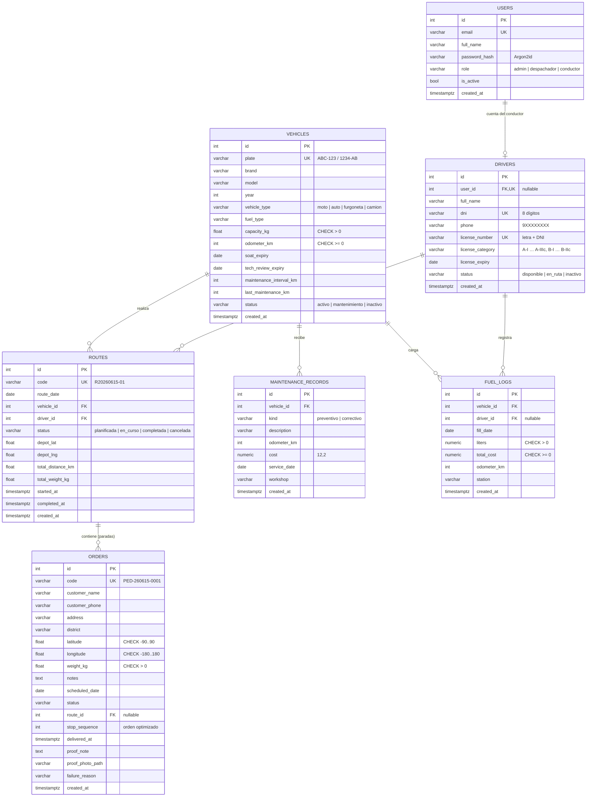

# Modelo de datos

Esquema creado por la migración `backend/alembic/versions/0001_esquema_inicial.py`. Los estados se guardan como `VARCHAR` (no `ENUM` nativo) para poder agregar valores sin migraciones complejas; la aplicación valida los valores permitidos.

## Tablas

| Tabla | Propósito | Notas de diseño |
|---|---|---|
| `users` | Cuentas de acceso y rol | Email único (comparación en minúsculas). El hash nunca sale en los DTOs. |
| `vehicles` | Unidades de la flota | La placa se guarda **normalizada** para que la restricción `UNIQUE` sea efectiva. El estado de documentos/mantenimiento **no se guarda**: se calcula (ver ADR 0003). |
| `drivers` | Conductores | `user_id` es opcional y único: vincula al conductor con su cuenta para la app móvil. DNI y licencia únicos. |
| `routes` | Recorrido de un vehículo + conductor en una fecha | Guarda el depósito usado (si cambia la configuración, las rutas históricas no se alteran) y la distancia/carga calculadas. Índice `(route_date, status)` para la regla "una ruta activa por día". |
| `orders` | Pedidos de entrega y su prueba | `route_id` + `stop_sequence` definen el orden de visita. `ON DELETE SET NULL` en la ruta conserva el pedido. Índice `(scheduled_date, status)` para el planificador y el dashboard. |
| `maintenance_records` | Historial de servicios | Un preventivo actualiza `vehicles.last_maintenance_km`. |
| `fuel_logs` | Cargas de combustible | El km/l se calcula entre cargas consecutivas (no se guarda, así corregir una carga no deja datos inconsistentes). |

## Montos y decimales

`cost`, `liters` y `total_cost` usan `NUMERIC` en la base (exactitud decimal) y se exponen como `float` en JSON para simplificar el frontend.

## Fechas y zona horaria

- `DATE` para vencimientos y fechas operativas; se comparan contra "hoy" en **hora de Lima (UTC-5)**.
- `TIMESTAMPTZ` para eventos (`created_at`, `delivered_at`), almacenados en UTC.
